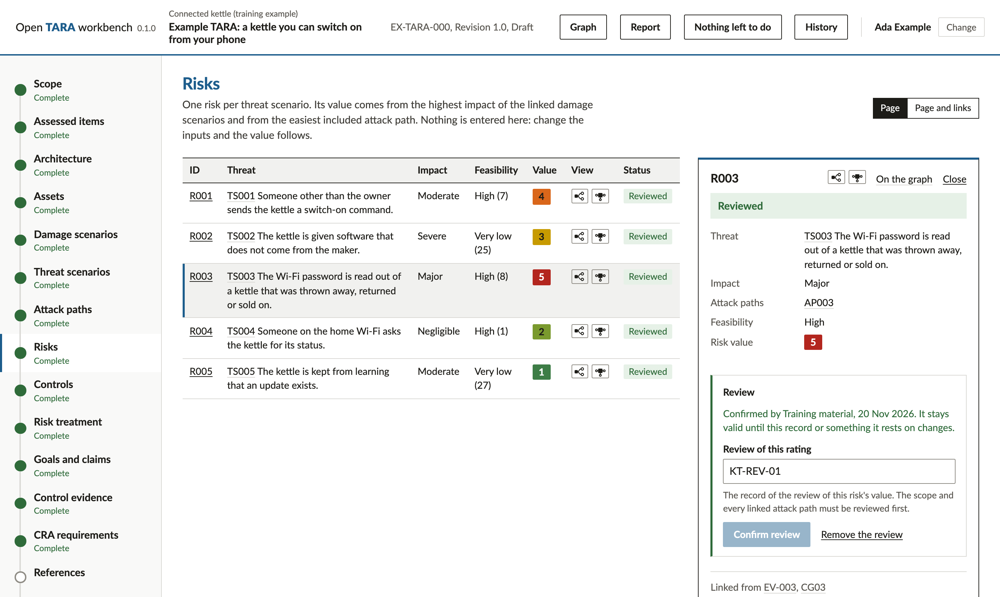

# Open TARA workbench

An open-source tool for threat analysis and risk assessment (TARA) of products with digital elements. It follows the method of ISO/SAE 21434 and covers the essential requirements of the EU Cyber Resilience Act, from the first description of the product to a signed report.

It is made first of all for teaching yourself TARA: three worked examples show a finished assessment, and in your own the tool says at every step what is still missing. It is open source under the Apache License 2.0, so you are free to change it and to use it in your own work.

It runs on your own machine or on a server in your organisation. Everything you enter stays there, as plain files you can read.

**Website: <https://ganindu7.github.io/cratool-tara-oss/>**, with the documentation laid out for reading. Every page there leads back to this repository.



## What it does

A TARA answers four questions, and the tool is laid out along them:

1. **What are we assessing?** The scope, the item, and its architecture as a data flow diagram with trust boundaries.
2. **What could go wrong, and how bad would it be?** Assets, damage scenarios rated in four categories, and threat scenarios.
3. **How easy is it, and so how big is the risk?** Attack paths rated by attack potential. The risk value, from 1 to 5, is worked out for you.
4. **What do we do about it, and how do we know it works?** Controls, the treatment of each risk, goals and claims, the evidence that a control works, and a decision on each of the 21 essential requirements of CRA Annex I.

Along the way the tool tells you, for every record, the one next thing it needs. A record of the chain, from the architecture to the goals and claims, can also be looked at as a drawing, with what it is linked to around it, and the chain as one graph. When a review is recorded, it remembers exactly what the review covered, and asks for the review again if that changes. At the end it produces the report: one self-contained web page, laid out for print.

Three complete examples come with it: a kettle you can switch on from your phone, a smart door lock, and a remote service gateway for a machine.

## Run it

### With Docker

This is the quickest way: Docker is all you need. That is Docker Desktop on macOS and Windows, or Docker Engine with the Compose plugin on Linux.

```sh
git clone https://github.com/ganindu7/cratool-tara-oss.git
cd cratool-tara-oss
mkdir data            # where your TARAs are kept: made by you, so that it belongs to you
docker compose up
```

The first start builds the image, which takes a minute or two. When the log names the tool and its version, open <http://localhost:8787> and open the kettle example from the start page. [Getting started](docs/getting-started.md) takes it from there.

| To                         | Run                                                           |
| -------------------------- | ------------------------------------------------------------- |
| Start it in the background | `docker compose up -d`                                        |
| Read its log               | `docker compose logs -f`                                      |
| See that it is well        | `docker compose ps`: the status ends in `(healthy)`           |
| Stop it                    | `docker compose down`, or Ctrl-C if it runs in the foreground |
| Update it                  | `git pull`, then `docker compose up --build`                  |

What to know:

- **Your data is not in the container.** It is in the `data` folder next to `compose.yaml`, as plain files you can read. Stopping, removing or rebuilding the container loses nothing. To back up, copy the folder.
- **Only this machine can reach the tool.** Compose publishes the port on `127.0.0.1`. The log has a note about the network: it is about the inside of the container, where the tool listens on every interface, and the port in `compose.yaml` is what keeps it to this machine. The tool has no sign-in of its own, so read [Deployment](docs/deployment.md) before you open it to a team.
- **If port 8787 is taken**, change the first number of the port in `compose.yaml`, for example to `"127.0.0.1:9000:8787"`, and open <http://localhost:9000>.
- **On Linux, the data folder must belong to the user the tool runs as.** That is user 1000, an ordinary user and not root. `mkdir data` before the first start sees to it on most machines. If `id -u` gives another number, set the `user:` line in `compose.yaml` to your own. If the tool does not stay up and the log says "The data folder /data cannot be written (EACCES)", Docker made the folder itself, as root: `sudo chown -R "$(id -u):$(id -g)" data` puts it right.

Without Compose, the same in two commands:

```sh
docker build -t tara-workbench .
docker run --rm -p 127.0.0.1:8787:8787 -e TARA_ALLOWED_HOSTS=localhost,127.0.0.1 -v "$PWD/data:/data" tara-workbench
```

### With Node.js

Node.js 22.18 or later, and nothing else:

```sh
git clone https://github.com/ganindu7/cratool-tara-oss.git
cd cratool-tara-oss
npm install
npm start
```

Then open <http://localhost:8787>.

Either way, your TARAs are kept in the `data` folder: one folder per TARA, holding the assessment as one JSON document and the history of every change.

## What it is not

- **Not a compliance guarantee.** The tool keeps an assessment complete, consistent and traceable. Whether the assessment is right is still a matter for people who know the product.
- **Not a multi-tenant service.** It has no sign-in of its own. It is built for one person's machine or a team's server behind the sign-in the organisation already has. [Deployment](docs/deployment.md) says how, and [Security](docs/security.md) says what the tool does and does not protect against.
- **Not a copy of any standard.** It contains no text of ISO/SAE 21434. The scoring method that comes with it, the Open TARA method, is built from sources that are free to reuse and names them.

## Documentation

|                                            |                                                           |
| ------------------------------------------ | --------------------------------------------------------- |
| [Getting started](docs/getting-started.md) | Run the tool, read an example, start your own TARA        |
| [The method](docs/method.md)               | The steps, how a risk value comes about, reviews, release |
| [The examples](docs/examples.md)           | Three worked TARAs and what each one teaches              |
| [The data](docs/data-format.md)            | The TARA document, the data folder, history, backups      |
| [Architecture](docs/architecture.md)       | How the code is laid out, and how to build on it          |
| [Deployment](docs/deployment.md)           | Your machine, a team server, settings                     |
| [Security](docs/security.md)               | What the tool protects against, and what is left to you   |
| [The API](docs/api.md)                     | Every route, with examples                                |
| [All documentation](docs/README.md)        | The full list                                             |

The same pages are published as [the project's website](https://ganindu7.github.io/cratool-tara-oss/), and each page there names the file it is made from, with a link back to it here.

## Working on the tool

```sh
npm install
npm run dev      # the server and the screens, both reloading as you edit; open http://localhost:5173
npm run check    # what CI checks first: types, lint, tests, licences, generated docs
```

The code is TypeScript throughout and runs without a build step: Node.js runs the sources directly. The layout:

| Path                  | What it holds                                                                                       |
| --------------------- | --------------------------------------------------------------------------------------------------- |
| `packages/core`       | The TARA document, the only way to change it, and the rule engine. Pure functions, no dependencies. |
| `packages/store`      | Where TARAs are kept. The only code that touches the data folder.                                   |
| `packages/report`     | The report: its content, and that content as one web page.                                          |
| `apps/server`         | The HTTP API. Thin: it passes requests to the store and the rule engine.                            |
| `apps/web`            | The screens. They talk to the API and to nothing else.                                              |
| `methods`, `examples` | Data that comes with the tool: the scoring method and the example TARAs.                            |
| `docs`, `site`        | The documentation, and the script that turns it into the website.                                   |

[Architecture](docs/architecture.md) explains the design and walks through common changes. [CONTRIBUTING.md](CONTRIBUTING.md) says how to propose one. If you work with a coding agent, [AGENTS.md](AGENTS.md) is written for it.

## Licence

Apache License 2.0: see [LICENSE](LICENSE) and [NOTICE](NOTICE). The software this project builds on is listed, with its licences, in [THIRD_PARTY_LICENSES.md](THIRD_PARTY_LICENSES.md).
