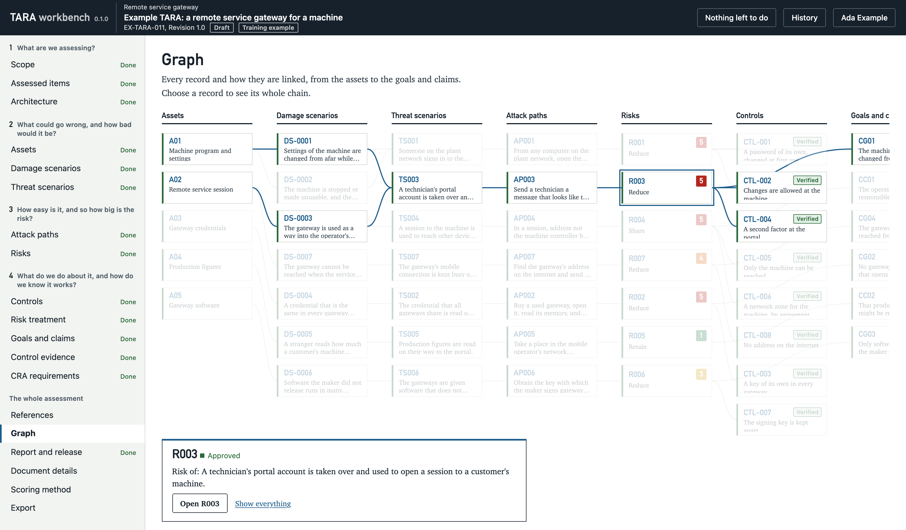

# The examples

Three complete TARAs come with the tool, for learning the method and the tool. The products are invented. The method, the checks and the kinds of document are the real ones. Each example is there for a lesson the others do not give; read them in this order.

| Example     | The product                                                         | The lesson                                                                                                                                                         |
| ----------- | ------------------------------------------------------------------- | ------------------------------------------------------------------------------------------------------------------------------------------------------------------ |
| `kettle`    | A kettle that can be switched on from a phone                       | **How a risk value comes about.** Five risks that land on the five values, each for a different reason. Needs no background; about fifteen minutes.                |
| `door-lock` | A smart door lock: Bluetooth, a cloud account, guest keys           | **What a TARA of an ordinary connected product looks like.** Every threat is of a kind found in real locks. The easiest attack needs no access to the lock at all. |
| `gateway`   | A remote service gateway that a machine builder fits into a machine | **A product in someone else's plant.** Two trust boundaries, a risk to people at a machine, a risk shared with the operator, and controls that are procedures.     |

The door lock and the gateway are written as the assessment of a real product is: for the design as first built, with the controls the assessment then asked for.

## Open one

On the start page, under "Learn from an example", choose one. It is copied into your data folder and opens at its guide: a short text, kept as the first document of the TARA, that says how to read it and what to try.

Every record is complete and every review confirmed, so every step shows "Done" and the TARA waits only for its three signatures. You can sign and release one, or change something and watch which checks and reviews react.

An example is yours to break. From the command line:

```sh
npm run examples                      # loads every example that is not there yet
npm run examples -- kettle            # loads one
npm run examples -- gateway --replace # puts a fresh copy in place of the one that is there
```

## What each holds

|                              | Kettle         | Door lock               | Gateway                       |
| ---------------------------- | -------------- | ----------------------- | ----------------------------- |
| Trust boundaries             | 1              | 1                       | 2                             |
| Assets                       | 4              | 5                       | 5                             |
| Damage scenarios             | 5              | 5                       | 7                             |
| Threat scenarios             | 5              | 7                       | 7                             |
| Attack paths                 | 5              | 7                       | 7                             |
| Risk values before treatment | 1, 2, 3, 4, 5  | 2 to 5                  | 1 to 5                        |
| Treatments                   | reduce, retain | reduce, avoid, retain   | reduce, share, retain         |
| Controls                     | 3              | 7, one of them proposed | 8, two of them organisational |
| CRA requirements             | all 21 apply   | all 21 apply            | all 21 apply                  |

## The kettle, value by value

| Risk                                                     | Damage     | Attack                       | Value | After | What it shows                                                                                                  |
| -------------------------------------------------------- | ---------- | ---------------------------- | ----- | ----- | -------------------------------------------------------------------------------------------------------------- |
| R003: the Wi-Fi password is read from a discarded kettle | Major      | Easy                         | 5     | 2     | Bad and easy is the top of the scale. A control that makes the attack very hard brings it down.                |
| R001: a guest switches the kettle on                     | Moderate   | Easy                         | 4     | 1     | Easy counts for a lot: moderate damage, yet a 4.                                                               |
| R002: altered software                                   | Severe     | Very hard                    | 3     | 3     | The worst damage is not the highest risk. The control does not lower the value; it keeps the attack that hard. |
| R004: someone reads the status                           | Negligible | As easy as it gets           | 2     | 2     | Easy and harmless is low. Retained, with a claim that says who accepted it.                                    |
| R005: updates are held back                              | Moderate   | Out of almost anyone's reach | 1     | 1     | Low for the opposite reason. Retained.                                                                         |

It also shows what a TARA is (four questions, and the steps that answer each), where security relies on a safety measure and says so, and that a retained risk needs no control but does need a sentence someone stands behind.

## What the door lock adds

- For a connected product the account is usually the weakest door: the easiest attack sums to zero points and needs no access to the lock.
- Assessing the design as first built, and letting the assessment change it.
- Residual risks that honestly stay at 4, and a control that is proposed for the next release. Its action shows in the action plan under Export.
- Avoiding a risk by removing a service port, with the evidence that it is gone.
- Saying what is left out and where it is handled: the mechanical lock, the phone, the router, the cloud service.

## What the gateway adds

- Two trust boundaries, and why the outer one decides what reaches the inner one.
- A safety impact, and how a TARA relies on a safety function that is assessed elsewhere.
- One secret shared by all devices: the mistake that turns one device's problem into every device's.
- A physical control, a key switch, that still holds when everything else has failed.
- Sharing a risk with the operator of the plant: what the maker does, what the manual asks of the operator, and the record that it was done.
- Organisational controls and their evidence: an agreement, an audited procedure.



## How they are kept

Each example is one file, `examples/kettle.json` and so on, in exactly the format the tool stores a TARA in. They are data, not code: reading one is the quickest way to learn [the format](data-format.md), and the tests run the rule engine against them, so a rule that changes a result shows up there.

To add an example, build it in the tool, export it (Export, "The TARA itself"), set `"example": true` in its `meta`, and put the file into `examples/`.
