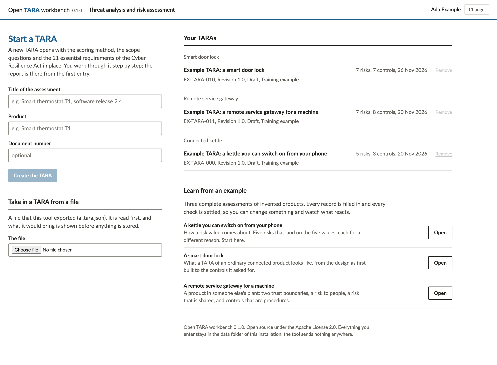
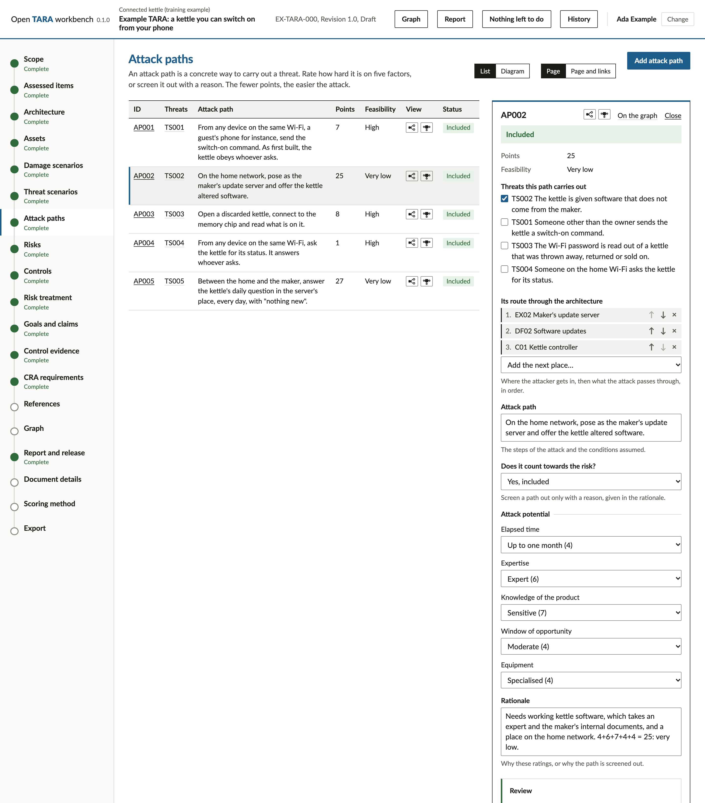
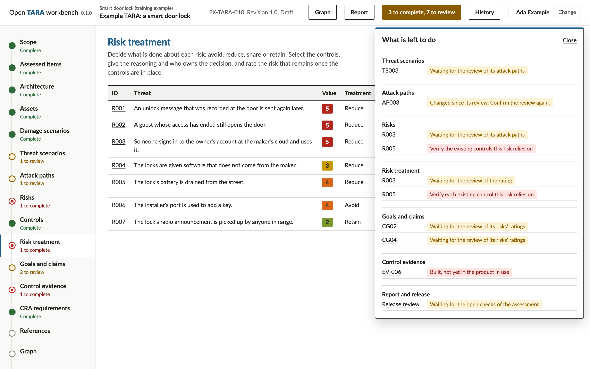
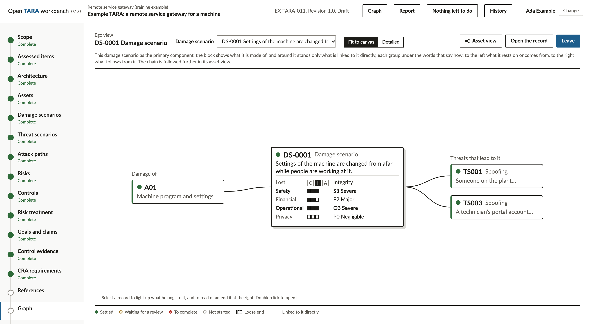
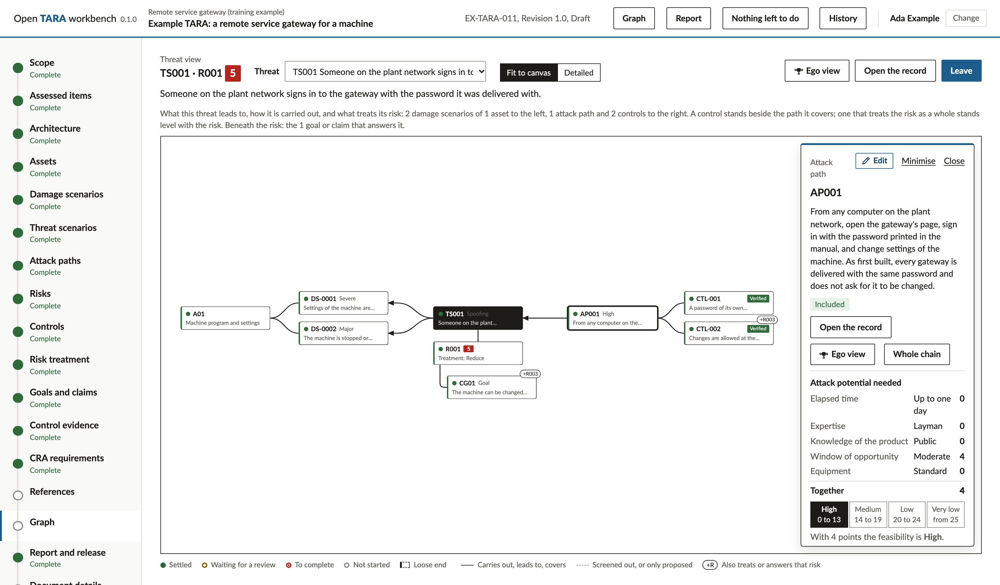
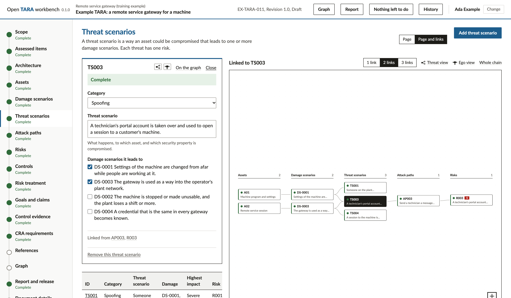

# Getting started

This page takes you from nothing to your first TARA: run the tool, read the smallest example, then start an assessment of your own. Allow half an hour.

## 1. Run the tool

You need either Docker, or Node.js 22.18 or later. Nothing else: there is no database to set up.

**With Docker**

```sh
git clone https://github.com/ganindu7/cratool-tara-oss.git
cd cratool-tara-oss
mkdir data            # where your TARAs are kept: made by you, so that it belongs to you
docker compose up
```

The first start builds the image, which takes a minute or two. `docker compose up -d` runs the tool in the background and `docker compose down` stops it; your data stays where it is. Make the `data` folder yourself, as above: on Linux a folder that Docker makes belongs to root, and the tool, which runs as an ordinary user, cannot write to it. [The README](../README.md) has the rest: the log, updating, another port.

**With Node.js**

```sh
git clone https://github.com/ganindu7/cratool-tara-oss.git
cd cratool-tara-oss
npm install
npm start
```

Open <http://localhost:8787>. The tool listens on this machine only; nobody else on the network can reach it.



Before you change anything, say who you are: the button is at the top right. Your name is recorded with your changes, on the reviews you confirm and under what you sign. It is a label, not a sign-in.

## 2. Read the kettle

On the start page, under "Learn from an example", open the first one: a kettle you can switch on from your phone. It opens at its guide, a short text that says how to read it. Follow the steps on the left from top to bottom. It takes about ten minutes, and it is the fastest way to see what a finished TARA holds and why.

Then try the things the guide suggests. For instance, open attack path AP002 and change "Expertise" from Expert to Proficient:



The points of the path fall from 25 to 22, its feasibility rises from very low to low, and risk R002 goes from 3 to 4. The review of the path now says that what it covered has changed, and so do the reviews that rest on it. Open History, at the top, to see your change and undo it.

An example is yours to break. `npm run examples -- kettle --replace` puts a fresh copy in its place. With Docker, where that script is not at hand, remove the example on the start page and load it again.

## 3. Start your own

On the start page, give the assessment a title and create it. A new TARA already holds the scoring method, the scope questions, and a decision to make for each of the 21 essential requirements of CRA Annex I.

Work from the top of the list on the left:

- **Scope.** Say which product and configuration is assessed, what it is for, and whether the CRA applies. Every later rating waits for the scope to be reviewed, so it is worth settling early.
- **Assessed items and Architecture.** Describe the system, then draw it: its components, the outside parties it talks to, the stores, the data flows, and the trust boundaries. Switch the Architecture step to "Diagram" to draw.
- **Assets, damage scenarios, threat scenarios.** What is worth protecting, what happens if it is compromised, and what could bring that about. On the diagram, drag each asset into the element it lives in.
- **Attack paths and risks.** How each threat could actually be carried out, and how hard that is. The risk values follow from your entries.
- **Controls, risk treatment, goals and claims, evidence.** What is done about each risk, and how you know it works.
- **CRA requirements.** One decision per requirement.

You never have to guess what is missing. Each record shows one status: the next thing it needs. The line under each step on the left says how much of it is still to complete or to review, and the button at the top that counts both lists everything that is still open, by step.



The report is there from your first entry, under "Report and release", and it is marked as a draft until the assessment is signed and released.

## 4. Look at it as a picture

A TARA is a web of records, and some things are easier to see than to read. The records of the chain, from the architecture to the goals and claims, can also be looked at as a drawing:

- **Page and links.** At the top right of a step, choose "Page and links": the list stays, and beside it stands the open record with what it is linked to. Choose a record there to go to it.
- **The views of a record.** The two signs beside a record lead to its drawings. One follows the chain of the method from it: what an asset can suffer and by which ways, what a threat leads to and what treats its risk, what an element is joined to, where a control acts. The other is its ego view: the record in the middle, as a block that shows what it is made of, with only what is linked to it directly.
- **The graph.** "Graph", at the top of every page, shows the records from the item to the goals and claims, and their links. Choose a record and its whole chain lights up.



On the graph, in a view and on the architecture diagram, a record that is chosen shows its card: how it stands, its ratings drawn, and what it is linked to. "Edit" on the card lets you amend the record where you see it. "Leave", at the top of a view, brings you back to where you were.





## Where your work is kept

In the `data` folder, next to the code:

```
data/
  taras/
    my-first-tara/
      tara.json        the assessment, as one readable document
      history.jsonl    every change, with who made it
```

To back up, copy the `data` folder. To move to another machine, copy it there. [The data](data-format.md) describes the files.

## Next

- [The method](method.md) explains each step and how the values come about.
- [The examples](examples.md) says what the door lock and the gateway add to the kettle.
- [Deployment](deployment.md), if a team is going to share one installation.
