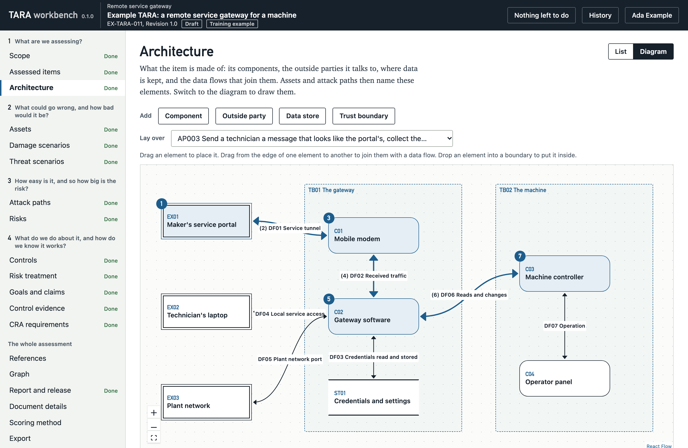
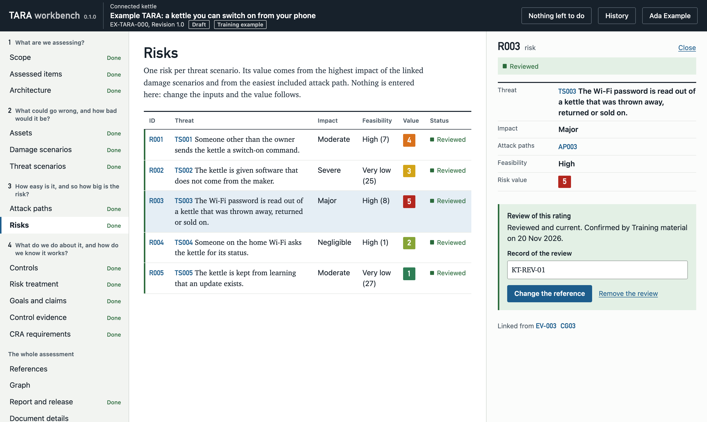
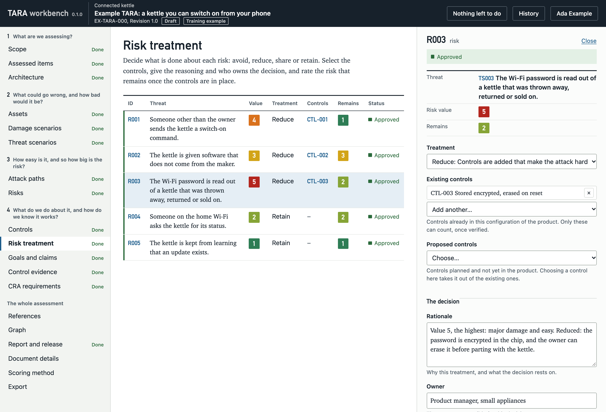
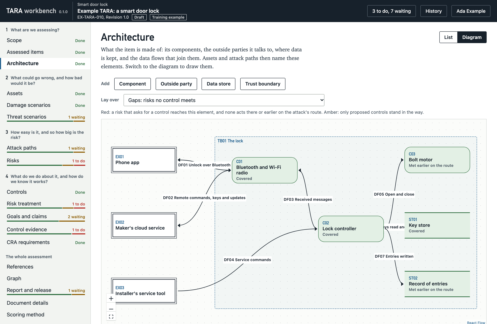

# The method

A threat analysis and risk assessment asks what could go wrong with a product through an attack, how bad that would be, how likely it is, and what is done about it. This page describes how the tool takes you through that, and how every value in it comes about.

The structure follows ISO/SAE 21434, clause 15, which is written for road vehicles but describes a method that fits any product with digital elements. The Cyber Resilience Act (Regulation (EU) 2024/2847) requires manufacturers to carry out such an assessment and to keep it in the technical documentation. The tool contains no text of the standard, and you do not need the standard to use it.

## Four questions

The steps of the tool follow four questions.

### 1. What are we assessing?

| Step           | What you enter                                                                                                                                                    |
| -------------- | ----------------------------------------------------------------------------------------------------------------------------------------------------------------- |
| Scope          | The configuration assessed, the intended and foreseeable use, the support period, what is left out, and whether the CRA, ISO/SAE 21434 and UN R155 apply.         |
| Assessed items | The system or function the assessment is about: its boundary, its interfaces, where it is used. Most assessments have one item.                                   |
| Architecture   | What the item is made of: components, outside parties, data stores, the data flows between them, and trust boundaries. Shown as a list or as a data flow diagram. |

A trust boundary is the line where something that is not trusted meets something that is. What crosses it has to be checked. Most threats cross one.

### 2. What could go wrong, and how bad would it be?

| Step             | What you enter                                                                                                           |
| ---------------- | ------------------------------------------------------------------------------------------------------------------------ |
| Assets           | What is worth protecting: a function, data, or a component. Each asset lives somewhere in the architecture.              |
| Damage scenarios | Who is harmed and how, when an asset loses confidentiality, integrity or availability. Each is rated in four categories. |
| Threat scenarios | A way an asset could be compromised that leads to one or more damage scenarios.                                          |

A damage scenario is rated from 0 (negligible) to 3 (severe) in four categories: safety, financial, operational and privacy. **Its impact is the highest of the four.** The method gives criteria for each level in each category; hover over a choice to read them, or open "Scoring method".

### 3. How easy is it, and so how big is the risk?

| Step         | What you enter                                                                                     |
| ------------ | -------------------------------------------------------------------------------------------------- |
| Attack paths | A concrete way to carry out a threat. Either rated on five factors, or screened out with a reason. |
| Risks        | Nothing. One risk exists per threat scenario, and its value follows from the entries above.        |

An attack path is rated by **attack potential**, the scheme of the Common Criteria: how much an attacker has to bring. Five factors each give points:

| Factor                | The question                                                                   |
| --------------------- | ------------------------------------------------------------------------------ |
| Elapsed time          | How long does it take to find and carry out the attack?                        |
| Expertise             | How skilled must the attacker be?                                              |
| Knowledge of the item | How much must be known about the product, and how available is that knowledge? |
| Window of opportunity | How much access is needed, and for how long?                                   |
| Equipment             | What tools are needed?                                                         |

The points are added up. The total falls into a band, and the band is the **attack feasibility**. Fewer points mean an easier attack and a higher feasibility:

| Points     | Feasibility |
| ---------- | ----------- |
| 0 to 13    | High        |
| 14 to 19   | Medium      |
| 20 to 24   | Low         |
| 25 or more | Very low    |

A threat can have several attack paths. **The easiest one that is included decides**, because an attacker takes the easiest way in.

The **risk value** is then read from the risk matrix: the impact of the threat (the highest impact among its damage scenarios) against its feasibility.

| Impact     | Very low | Low | Medium | High |
| ---------- | -------- | --- | ------ | ---- |
| Severe     | 3        | 4   | 5      | 5    |
| Major      | 2        | 3   | 4      | 5    |
| Moderate   | 1        | 2   | 3      | 4    |
| Negligible | 1        | 1   | 2      | 2    |

So the worst damage is not always the highest risk, and neither is the easiest attack. The kettle example is built to show this: its five risks land on the five values, each for a different reason.

These tables are those of the Open TARA method 1.0, which comes with the tool. The method is data, not code. See "The scoring method" below.

### 4. What do we do about it, and how do we know it works?

| Step             | What you enter                                                                                                                       |
| ---------------- | ------------------------------------------------------------------------------------------------------------------------------------ |
| Controls         | The security measures the product has or will get, where each acts in the architecture, and which CRA requirements it supports.      |
| Risk treatment   | For each risk: avoid, reduce, share or retain. The controls that treat it, why, who owns the decision, and the risk that remains.    |
| Goals and claims | A risk that is reduced needs a cybersecurity goal. A risk that is retained or shared needs a claim that says why that is acceptable. |
| Control evidence | For each control a risk relies on: what it achieves for that risk, where it is implemented, and the test that showed it works.       |
| CRA requirements | For each of the 21 essential requirements of Annex I: does it apply, why, and where is it implemented and verified.                  |

Two rules keep this honest:

- **Only a verified control counts.** A control is proposed, under way, built, live or verified. A risk can rely on a control only once it is in the product and a test has shown that it works. A reduced risk needs at least one.
- **A control never lowers the value by itself.** You rate the risk that remains, and say what the rating rests on. Sometimes a control does not lower the value at all: it keeps a hard attack hard.

The "Gaps" view on the architecture diagram shows where a risk lands that no control meets: a risk reaches this element, and nothing acts there or on the way to it.

## The checks

Every record shows one status, and it is always the next thing to do. Behind it is a ladder: an ordered list of conditions, where the first that applies decides. What a person has to enter comes before what the record has to wait for.

| Kind            | Meaning                                                                |
| --------------- | ---------------------------------------------------------------------- |
| To do (red)     | An entry of this record is missing or does not fit.                    |
| Waiting (amber) | The record is complete and waits for something else, usually a review. |
| Done (green)    | Nothing to do.                                                         |

[The checks](reference/checks.md) lists every status.

## Reviews

A review in this tool is more than a tick. When you record a review of an attack path, a risk rating, a treatment, a goal, a piece of evidence, a CRA decision or the scope, you name the record of that review: the minutes, an approval number, a document.

The tool then takes everything that review covered, the record itself and every input its result depends on, and keeps a fingerprint of it. The review stays current for as long as that content is unchanged. Change a damage rating, and the review of every risk that rests on it says so and asks to be confirmed again. Nothing that was reviewed can change quietly.

A review can only be confirmed when the record is otherwise complete: a review of something unfinished would be a review of something else. Reviews also build on each other in an order. A rating can be reviewed once its attack paths are; a treatment once its rating and its goal are.

## Release

When no check is open, the release review is recorded, and three people have signed as author, reviewer and approver, the TARA can be released. The approver must be someone other than the author. A signature covers the assessment as it stood when it was given: a later change asks for it again.

A released TARA is frozen. Its report is kept exactly as it was issued. Work continues in a new revision, which carries everything over, keeps every ID, and asks for each review again, because the revision of the document is part of what a review covers.

## The scoring method

How impact, feasibility and risk are rated is not built into the code. It is a file, `methods/open-tara-1.0.json`, and every TARA carries its own copy. An assessment made today gives the same values in ten years, whatever the tool's default has become by then.

The **Open TARA method 1.0** that comes with the tool was put together from sources that are free to reuse, and names them:

| Part                                                                                          | Source                                                                                 |
| --------------------------------------------------------------------------------------------- | -------------------------------------------------------------------------------------- |
| Structure: four impact categories at four levels, four feasibility levels, risk values 1 to 5 | The requirements of ISO/SAE 21434:2021, clause 15. Only the structure is taken.        |
| Attack feasibility: the five factors, their points and the bands                              | Common Methodology for Information Technology Security Evaluation, CEM:2022, Annex B.6 |
| Risk matrix                                                                                   | Lautenbach, Almgren, Olovsson: Proposing HEAVENS 2.0, CSCS '21, Table 8                |
| Impact criteria and all descriptions                                                          | Written for this method                                                                |

To use your organisation's own method, copy the file, change the wording, the options and their points, the bands and the matrix, and put it into `data/methods/`. It is then offered when a TARA is created, and an existing TARA can switch to it under "Scoring method". The shape is fixed, because the records depend on it: four impact categories, four levels, five factors, four feasibility ratings, values 1 to 5. The tool refuses a method that leaves a gap, for example a band that does not start where the last one ended, or a matrix in which an easier attack gives a lower value.

## What the tool does not decide

The tool keeps an assessment complete, consistent and traceable. It does not know your product. Whether an asset was overlooked, whether a rating is honest, whether a control really does what its description says: those are judgements, and they are yours and your reviewers'.
